<div align="center">


### *For when you're technically an Isko, but proCramming-level procrastinating.*

**BOOGSH K.O. ka later!!**


*Author: **Percie Louise Y. Samaniego** · Branch: `main` (merged from `act4-refactor`)*

</div>

---

A student-friendly to-do list app built with **Flutter + Firebase** across four incremental CMSC 128 labs:

| Lab | Milestone | What It Added |
| :---: | :--- | :--- |
| **Lab&nbsp;1** | Core CRUD | Task creation, editing, completion, soft-delete + Undo, tags, priorities, and Calendar view |
| **Lab&nbsp;2** | Accounts & Auth | Email/Password registration, login, session persistence (`AuthGate`), Profile editing, and Forgot Password |
| **Lab&nbsp;3** | Multi-Account UBAC | Per-user data isolation (`ownerId`), server-side `firestore.rules` (RLS), Collaborative Lists, and merged Calendar |
| **Lab&nbsp;4** | Refactor & Deployment | Code/Backend optimization (eliminated N+1 queries), `MediaQuery` phone-ratio responsiveness, IDOR Pentesting, and Release Android `.apk` |

---

## 📑 Contents

- [📱 Accessing the Deployed App (Expanded Mobile Tier)](#-accessing-the-deployed-app-expanded-mobile-tier)
- [✨ What Was Refactored & Optimized (Lab 4)](#-what-was-refactored--optimized-lab-4)
- [🖼️ App Screenshots](#️-app-screenshots)
- [🛠️ Tech Stack & Project Structure](#️-tech-stack--project-structure)
- [🗄️ Data Model & Relational Schema](#️-data-model--relational-schema)
- [🔌 Example API Endpoints & Access Control](#-example-api-endpoints--access-control)
- [🛡️ Bonus: Penetration Testing & Safeguards](#️-bonus-penetration-testing--safeguards)
- [💻 Local Setup & Installation](#-local-setup--installation)
- [🔍 Inspecting Accounts & Tasks (Defense Deliverable)](#-inspecting-accounts--tasks-defense-deliverable)

---

## 📱 Accessing the Deployed App (Expanded Mobile Tier)

IsKO-LATER is shipped as a standalone **Release Android `.apk`** (`flutter build apk --release`) connected directly to hosted **Firebase Authentication** and **Cloud Firestore**. It works independently on any Android phone over any network, even when my development laptop is turned off.

> **📦 Download Release APK (Google Drive):** `https://drive.google.com/drive/folders/10AGn7Lyl0dBuQfpbMD5NTKRnmDnufAC_`

### Installation Steps (Android Phone)
1. Open the Google Drive link above on your Android phone *(use Chrome or an Incognito tab if multiple Google accounts are signed in)* and download **`IsKO-LATER-release.apk`**.
2. Tap **"Download anyway"** if Google Drive notes it cannot virus-scan files over 50 MB.
3. Open **Files / Downloads** and tap **`IsKO-LATER-release.apk`**.
4. When prompted, allow **"Install unknown apps"** for your browser or Files app, then tap **Install** *(if Play Protect prompts, choose **More details → Install anyway**)*.
5. Launch **IsKO-LATER** from your home screen, register a new account (or log in), and manage your personal or collaborative tasks.

---

## ✨ What Was Refactored & Optimized (Lab 4)

### 1. Code Architecture (DRY & Clean Code)
- **Centralized Theme & Mappers ([`lib/utils/app_theme.dart`](lib/utils/app_theme.dart)):** Removed duplicated hex colors and 3 copies of `priorityColor` / `tagIcon` switch blocks across `TaskCard`, `AddEditTaskSheet`, and `CalendarScreen`.
- **Single-Pass Sorting & Overdue Grouping ([`lib/utils/task_helpers.dart`](lib/utils/task_helpers.dart), [`lib/screens/home_screen.dart`](lib/screens/home_screen.dart)):** Replaced a 3-allocation filter-and-sort with a **single-pass comparator** (incomplete tasks ordered by soonest deadline + highest priority; completed tasks ordered most recent first to prevent `serverTimestamp()` flicker). Fixed past-due tasks appearing under "Upcoming Tasks" by splitting Home into **Overdue**, **Today**, **Upcoming Tasks**, and **Completed Tasks** (with red title + exclamation icon on overdue cards).
- **Reusable Services, Auth Prefill & Tests:** Reused service instances per screen instead of allocating on every rebuild, wired `loginEmailPrefill` listener on `LoginScreen`, and replaced the template counter test in [`test/widget_test.dart`](test/widget_test.dart) with model, sorting, and sanitizer unit tests.

### 2. Backend & Database Optimization
| Area | Before (Lab 3) | After (Lab 4) | Impact |
| :--- | :--- | :--- | :--- |
| **Member Lookups** (`getListMembers`) | `for` loop calling `.doc(uid).get()` per member (**N+1 query**) | Batched `FieldPath.documentId` `whereIn` chunks (30 UIDs/query via `Future.wait`) | Cuts 10+ sequential round-trips down to **1 query** |
| **List Cascade Delete** (`deleteCollaborativeList`) | Sequential `for` loop deleting 1 task per network call | Atomic Firestore **`WriteBatch`** commit | Cuts $N$ deletes to **1 atomic batch** while keeping `isListMember()` rules valid |
| **Collaborator Invite** (`addMemberByEmailOrUsername`) | Downloaded the entire `users` collection every time | Fast-path indexed `.where('email', isEqualTo: ...).limit(1)` first | Reads **1 document** for exact email invites instead of scanning all users |
| **Task Updates** (`updateTask`) | Sent all 10 fields (`task.toMap()`) on every edit | Sends only the **4 mutable fields** (`title`, `dueDateTime`, `priority`, `tag`) | Smaller network payload & prevents overwriting concurrent `isDone` toggles |
| **Composite Indexes** (`firestore.indexes.json`) | No explicit index configuration | Indexed `tasks` (`ownerId`/`listId` + `createdAt`) & `todo_lists` (`memberIds` + `createdAt`) | Keeps UBAC-filtered queries fast as data grows |

### 3. UX/UI Polish & CMSC 134 HCI Best Practices
- **Phone-Ratio Compatibility via `MediaQuery` ([`lib/utils/responsive.dart`](lib/utils/responsive.dart), [`lib/main.dart`](lib/main.dart)):** Replaced hardcoded pixel heights (`height: 360` on `CalendarScreen`, `height: 250` on `ForgotPasswordScreen`) with `MediaQuery.sizeOf(context)` scaling and a short/landscape scrollable fallback so nothing gets cut off on any phone aspect ratio. Clamped OS `textScaler` (`0.85x–1.20x`) globally in `MaterialApp.builder`.
- **Consistent Feedback & Error Prevention ([`lib/widgets/confirm_dialog.dart`](lib/widgets/confirm_dialog.dart)):** Replaced default `AlertDialog`s across Delete Task, Log Out, Remove Member, Delete List, and Password Re-auth with one themed confirmation modal (`showAppConfirmDialog`).
- **Consistent Navigation ([`lib/widgets/app_shared.dart`](lib/widgets/app_shared.dart)):** Fixed duplicate route stacking in `AppBottomNav` using `pushReplacement` between secondary tabs so system Back always returns straight to `Tasks`.
- **Accessibility & Clean Branding:** Added `tooltip` / `Semantics` labels to every icon button and nav tab, sanitized all error messages via `TaskHelpers.friendlyError()`, and updated the Android 12+ splash screen to centered `logo.png` with launcher label **IsKO-LATER**.

---

## 🖼️ App Screenshots

### 1. Authentication Flow
<table>
  <tr>
    <th align="center">Login Screen</th>
    <th align="center">Register Screen</th>
    <th align="center">Forgot Password</th>
  </tr>
  <tr>
    <td align="center"></td>
    <td align="center">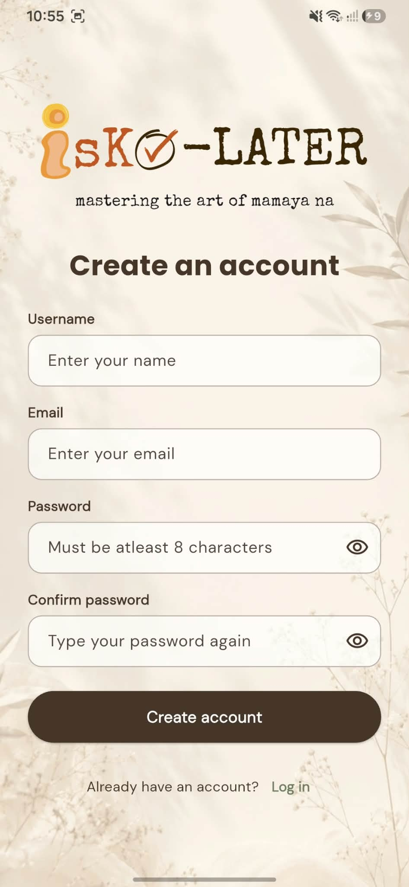</td>
    <td align="center">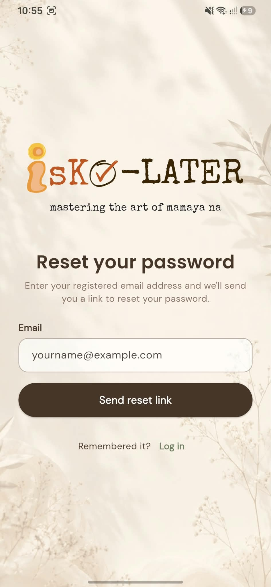</td>
  </tr>
</table>

### 2. Personal & Collaborative Task Lists
<table>
  <tr>
    <th align="center">Personal To-Do List</th>
    <th align="center">List Switcher Dropdown</th>
    <th align="center">Shared Collaborative List</th>
  </tr>
  <tr>
    <td align="center">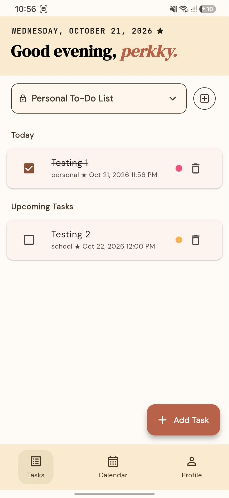</td>
    <td align="center">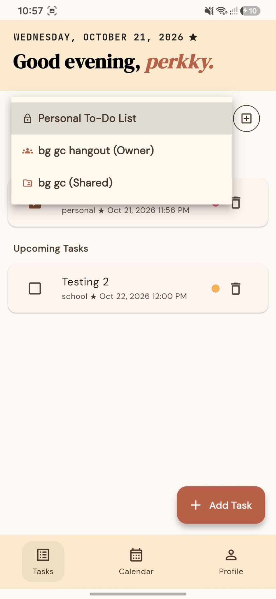</td>
    <td align="center">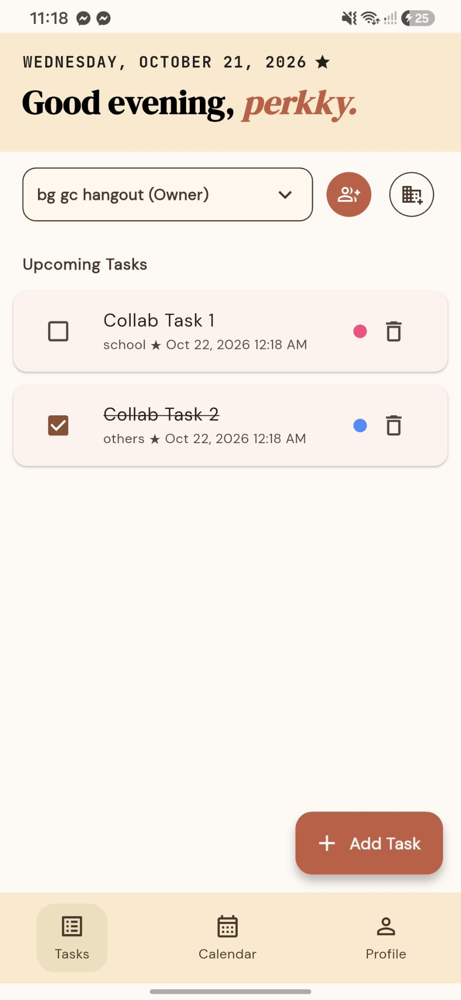</td>
  </tr>
</table>

### 3. Task & Collaborative Modal Sheets
<table>
  <tr>
    <th align="center">Add / Edit Task Sheet</th>
    <th align="center">Create Collab Space</th>
    <th align="center">Manage & Invite Members</th>
  </tr>
  <tr>
    <td align="center">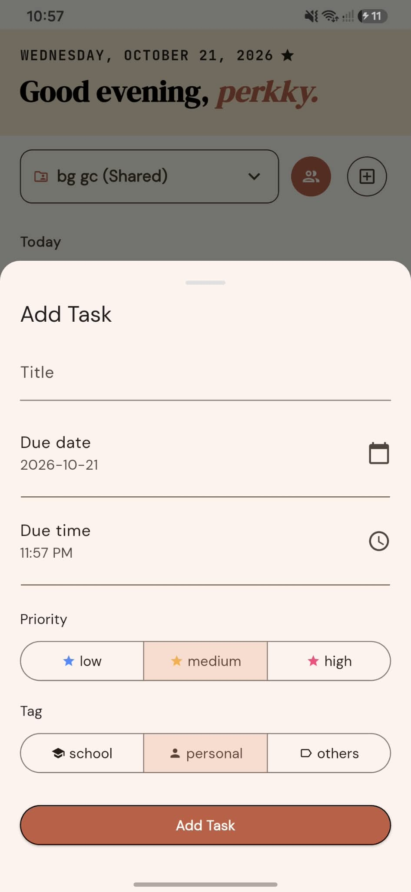</td>
    <td align="center">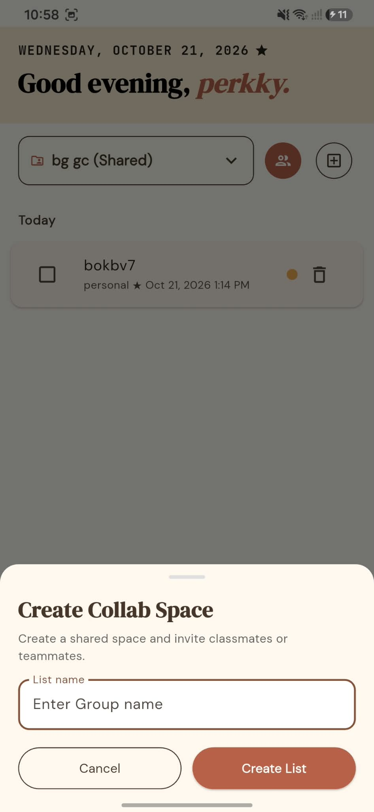</td>
    <td align="center">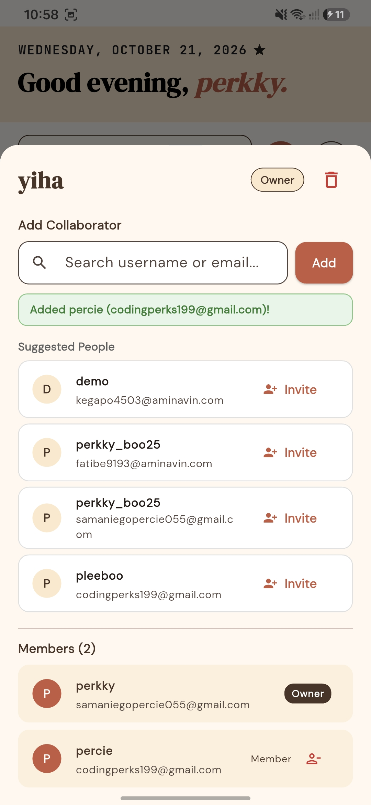</td>
  </tr>
</table>

### 4. Calendar & Profile
<table>
  <tr>
    <th align="center">Calendar View (Merged & Filtered)</th>
    <th align="center">Profile Screen</th>
  </tr>
  <tr>
    <td align="center">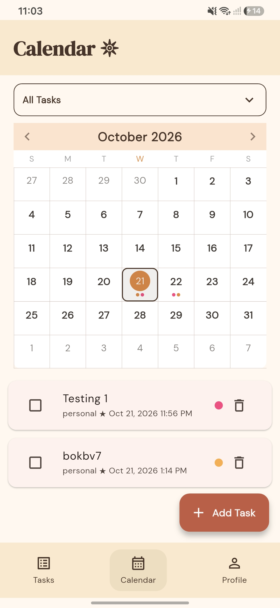</td>
    <td align="center">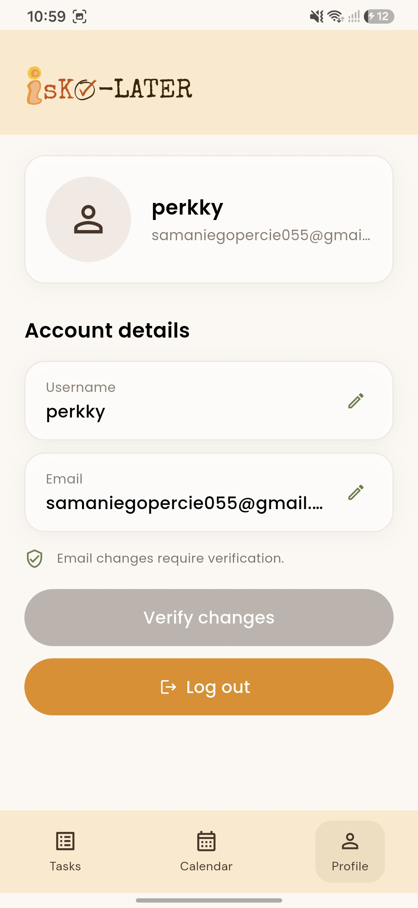</td>
  </tr>
</table>

### 5. Firebase Console (DB Inspection)
<p align="center">
  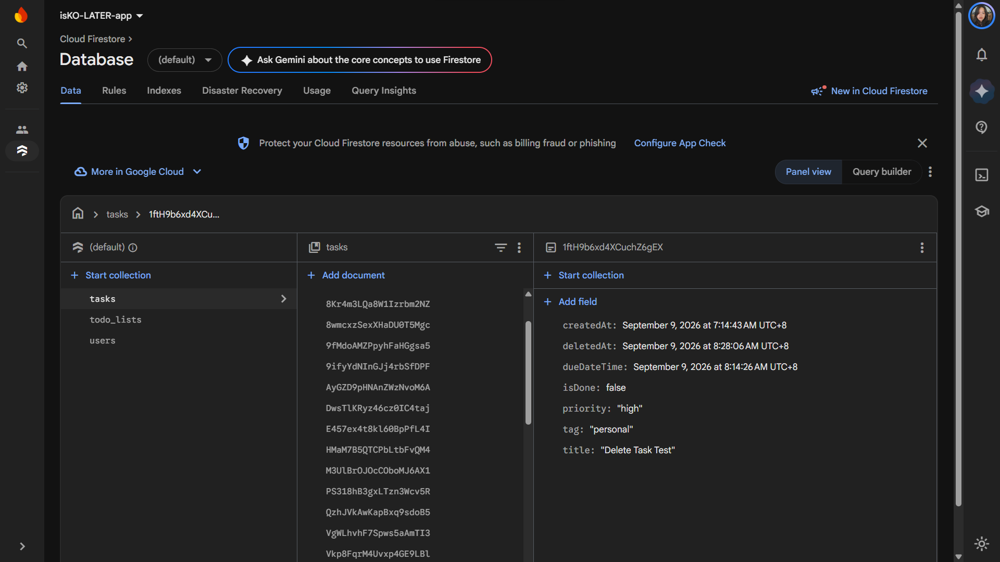
</p>

---

## 🛠️ Tech Stack & Project Structure

| Layer | Technology |
| :--- | :--- |
| **Frontend** | Flutter (Dart), Material 3 |
| **Backend** | Firebase (Serverless) |
| **Authentication** | Firebase Authentication (Email/Password) |
| **Database & RLS** | Cloud Firestore + `firestore.rules` + `firestore.indexes.json` |
| **Deployment** | Release Android `.apk` (`flutter build apk --release`) via Google Drive |
| **Packages** | `firebase_core`, `firebase_auth`, `cloud_firestore`, `syncfusion_flutter_calendar`, `google_fonts`, `intl` |

<details>
<summary><strong>📂 View Full Project Structure</strong></summary>

```text
cmsc128-Lab1_CRUD_Samaniego/
├── firestore.rules                  # Backend Row-Level Security (RLS) & IDOR prevention
├── firestore.indexes.json           # Composite index definitions for UBAC queries
├── firebase.json                    # Firebase project, rules, & indexes configuration
├── pentest/
│   ├── run_idor_pentest.ps1         # Direct Firestore REST API IDOR pentest script
│   └── firestore.insecure.rules     # Demo-only vulnerable rules for Before/After verification
├── lib/
│   ├── main.dart                    # Entry point, Firebase init, & MediaQuery textScaler guard
│   ├── firebase_options_example.dart# Safe config template (real firebase_options.dart gitignored)
│   ├── models/
│   │   ├── user.dart                # AppUser model (users/{uid})
│   │   ├── task.dart                # Task model with ownerId & listId foreign keys
│   │   └── todo_list.dart           # TodoList model with ownerId & memberIds array
│   ├── services/
│   │   ├── auth_service.dart        # Firebase Auth & user profile sync
│   │   ├── firestore_service.dart   # User-scoped & list-scoped Task CRUD (partial updates)
│   │   └── todo_list_service.dart   # Batched collab list CRUD & member lookups
│   ├── utils/
│   │   ├── app_theme.dart           # Centralized palette, priority colors, & tag icons
│   │   ├── responsive.dart          # MediaQuery phone-ratio scaling helpers
│   │   ├── task_helpers.dart        # Single-pass sorting, overdue checks, & friendly errors
│   │   └── input_sanitizer.dart     # Defense-in-depth script/operator input validation
│   ├── screens/                     # Auth, Home, Calendar, Profile, & modal sheets
│   └── widgets/                     # Shared nav, TaskCard, ListSwitcherBar, ConfirmDialog
└── test/
    └── widget_test.dart             # Unit tests for sorting, overdue, UBAC models, & sanitizer
```

</details>

---

## 🗄️ Data Model & Relational Schema

Users, Collaborative Lists, and Tasks live in **three normalized top-level Firestore collections** (`users`, `todo_lists`, and `tasks`). User profile fields (`userName`, `email`) are never duplicated inside task or list documents—relationships are strictly maintained via `uid` and `listId` foreign keys.

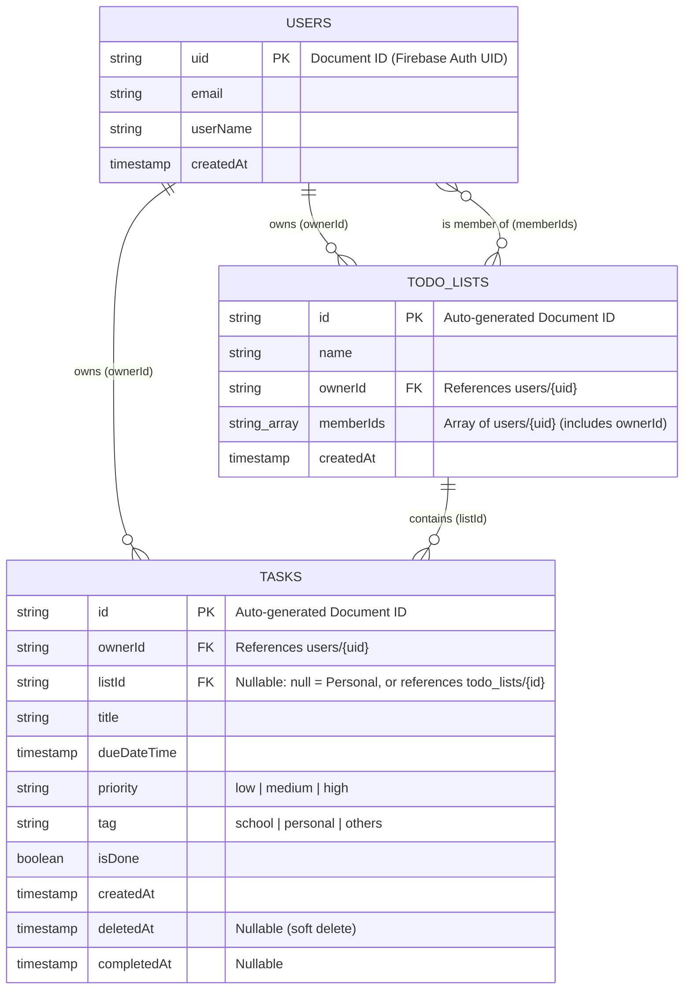

---

## 🔌 Example API Endpoints & Access Control

IsKO-LATER communicates with Cloud Firestore and Firebase Auth over HTTPS (through the FlutterFire SDK in-app and Google's Firestore REST API during pentesting):

| Operation | Endpoint / SDK Query | Server-Side Rule (`firestore.rules`) |
| :--- | :--- | :--- |
| **Sign In** | `POST https://identitytoolkit.googleapis.com/v1/accounts:signInWithPassword` | Verifies password hash & issues JWT `idToken` |
| **Read Personal Tasks** | `GET .../documents/tasks` · `_taskRef.where('ownerId', isEqualTo: uid)` | `resource.data.ownerId == request.auth.uid` |
| **Read Shared Tasks** | `_taskRef.where('listId', isEqualTo: listId)` | `isListMember(resource.data.listId)` |
| **Create Task** | `POST .../documents/tasks` · `_taskRef.add(...)` | `request.resource.data.ownerId == request.auth.uid` + `isValidTask()` |
| **Update Task** | `PATCH .../documents/tasks/{taskId}` · `_taskRef.doc(id).update({...4 fields})` | Locks `ownerId`, `listId`, `createdAt`; verifies owner or member |
| **Delete Task** | `DELETE .../documents/tasks/{taskId}` · `softDelete(task)` | Owner (personal) or list member (collaborative) |

---

## 🛡️ Bonus: Penetration Testing & Safeguards

### Attack Vector: Firestore IDOR & Owner Spoofing (Bypassing the App UI)
Because Firestore is reachable over HTTPS, a logged-in attacker (**Account B**) can bypass the Flutter UI completely and send direct HTTP requests to the Firestore REST API using Account B's JWT token while targeting **Account A's** private document ID or forging `ownerId`.

### Verification Script ([`pentest/run_idor_pentest.ps1`](pentest/run_idor_pentest.ps1))
```powershell
$env:FIREBASE_API_KEY = Read-Host "Firebase Web API Key"
$pwA = [Net.NetworkCredential]::new("", (Read-Host "Account A password" -AsSecureString)).Password
$pwB = [Net.NetworkCredential]::new("", (Read-Host "Account B password" -AsSecureString)).Password

.\pentest\run_idor_pentest.ps1 `
  -ProjectId "isko-later-app" `
  -EmailA "accountA@example.com" -PasswordA $pwA `
  -EmailB "accountB@example.com" -PasswordB $pwB `
  -VictimTaskId "<task_doc_id_owned_by_A>"
```

### Before vs. After Results

| Pentest Case | Attack Action (Bypassing UI) | Without UBAC Rules (`pentest/firestore.insecure.rules`) | With UBAC Rules (`firestore.rules`) |
| :--- | :--- | :--- | :--- |
| **1. IDOR Read** | Account B sends `GET /tasks/{A_taskId}` | `[200 OK]` — Account A's private task leaked | `[403 BLOCKED]` — `PERMISSION_DENIED` |
| **2. Owner Spoofing** | Account B sends `POST /tasks` with `ownerId = uidA` | `[200 OK]` — Forged task injected into A's list | `[403 BLOCKED]` — `PERMISSION_DENIED` |
| **3. IDOR Delete** | Account B sends `DELETE /tasks/{A_taskId}` | `[200 OK]` — Account A's private task wiped | `[403 BLOCKED]` — `PERMISSION_DENIED` |
| **4. Positive Control** | Account A sends `GET /tasks/{A_taskId}` | `[200 OK]` — Legitimate owner reads task | `[200 OK]` — Legitimate owner reads task |

> [!TIP]
> As a secondary defense-in-depth layer, [`lib/utils/input_sanitizer.dart`](lib/utils/input_sanitizer.dart) also rejects HTML/script tags (`<script>`, `onerror=`) and NoSQL operator syntax (`$ne`, `$where`) at both the form and service layers.

---

## 💻 Local Setup & Installation

### Prerequisites
- [Flutter SDK](https://docs.flutter.dev/get-started/install) (stable channel)
- [Firebase CLI](https://firebase.google.com/docs/cli) & [FlutterFire CLI](https://firebase.google.com/docs/flutter/setup)

### 1. Clone & Install Dependencies
```bash
git clone https://github.com/CMSC128-njh/cmsc128-Lab1_CRUD_Samaniego.git
cd cmsc128-Lab1_CRUD_Samaniego
flutter pub get
```

### 2. Configure Firebase *(Secrets Kept Out of Git)*
`lib/firebase_options.dart`, `android/app/google-services.json`, and `.env` are excluded via `.gitignore` (see [`lib/firebase_options_example.dart`](lib/firebase_options_example.dart)):
```bash
flutterfire configure
firebase deploy --only firestore --project <your-firebase-project-id>
```

### 3. Run, Test, or Build Release APK
```bash
flutter run                    # Run on connected device or emulator
flutter test                   # Run unit tests
flutter build apk --release    # Output: build/app/outputs/flutter-apk/app-release.apk
```

---

## 🔍 Inspecting Accounts & Tasks (Defense Deliverable)

Records can be inspected live in the **Firebase Console** without exposing plaintext passwords:
1. **Firebase Console → Authentication → Users:** Registered accounts (`Email`, `User UID`, `Created`, `Signed In`).
2. **Firebase Console → Firestore Database → Data:**
   - **`users`:** `uid` documents with `email`, `userName`, and `createdAt`.
   - **`tasks`:** `ownerId` (FK → `users/{uid}`) and nullable `listId` (FK → `todo_lists/{id}`).
   - **`todo_lists`:** `name`, `ownerId`, and `memberIds` array.

---

## Known Limitations
- Authentication is **Email/Password only** (no third-party OAuth providers yet).
- Updating an account's email requires clicking the verification link sent to the new address before the change takes effect.
