# IsKO-LATER ★
Author: Percie Louise Y. Samaniego
### *For when you're technically an Isko, but proCramming-level procrastinating.*

**BOOGSH K.O. ka later!!**

A simple to-do list app made for students who have **tasks everywhere and somehow still loves cramming**.
- **Lab 1** gave it the task management stuff (CRUD).
- **Lab 2** added **user accounts** (Authentication), because apparently even procrastination needs to know who is procrastinating.
- **Lab 3** merges them together with **User-Based Access Control (UBAC)** and **Collaborative To-Do Lists** - so your personal procrastination stays private, and your group cramming stays strictly within your group.

Built with **Flutter + Firebase** - because apparently even procrastination needs cloud support.

> **Course:** CMSC 128 · **Branch:** `act3-ubac`

---

## Contents

- [Features](#features)
- [App Screenshots](#app-screenshots)
- [How Activity 1 & Activity 2 Were Merged](#how-activity-1--activity-2-were-merged)
- [Tech Stack](#tech-stack)
- [Project Structure](#project-structure)
- [Data Model & Relational Schema](#data-model--relational-schema)
- [UBAC, RLS, & IDOR Security Operations](#ubac-rls--idor-security-operations)
- [Local Setup & Installation](#local-setup--installation)
- [Authentication Flow](#authentication-flow)
- [Inspecting Accounts & Tasks (Defense Deliverable)](#inspecting-accounts--tasks-defense-deliverable)
- [Known Limitations](#known-limitations)

---

## Features

### Tasks (Lab 1)

- Create, edit, complete, and soft-delete tasks (with undo)
- Priority (`low`, `medium`, `high`) and tag (`school`, `personal`, `others`) per task
- "Today" / "Upcoming Tasks" automatic grouping with completed tasks pushed to the bottom
- Calendar view with priority-colored dot markers on days that have tasks

### Accounts & Authentication (Lab 2)

- **Register** with full name, email, and password
- **Log in / Log out** with confirmation dialogs
- **Persistent session** - stays logged in across refreshes, back navigation, and app restarts
- **Protected screens (`AuthGate`)** - signed-out users only see the login flow
- **Direct Tasks Landing** - logging in takes the user straight to their own To-Do List
- **Profile Screen** - inline username and email editing with **current-password re-authentication** and **email verification handoff**
- **Forgot password** - sends a single-use reset link through email with account-enumeration protection

### Multi-Account UBAC & Collaborative Lists (Lab 3)

- **User-Based Access Control (UBAC)** - each user can only create, view, update, and delete **their own** personal tasks (`ownerId == currentUser.uid`)
- **Backend Row-Level Security (RLS)** - enforced on Google's Firestore servers via `firestore.rules`, preventing Insecure Direct Object References (**IDOR**) even if someone manipulates task/list IDs
- **Collaborative To-Do Lists** - create shared lists and switch seamlessly between your **Personal To-Do List** and any **Collaborative List** you own or were added to
- **Collaborator Invitations & Suggestions** - list owners can invite registered users by **username or email** (with live autocomplete suggestions), remove members, or delete the collaborative list
- **Merged & Filterable Calendar** - Calendar view merges your Personal + Collaborative tasks by default, with a downward dropdown filter to isolate **All Tasks**, **Personal Only**, or a specific **Collaborative List**

---

## App Screenshots

These are the pictures of the app.

### 1. Authentication Screens (Lab 2 + Lab 3)
| Login Screen | Register Screen | Forgot Password Screen |
| :---: | :---: | :---: |
| 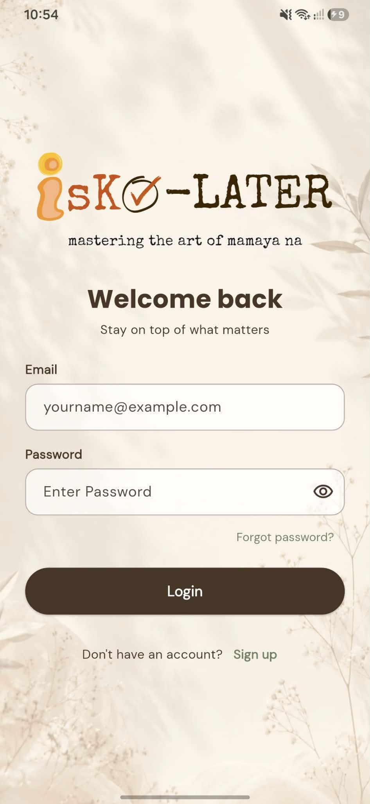 | 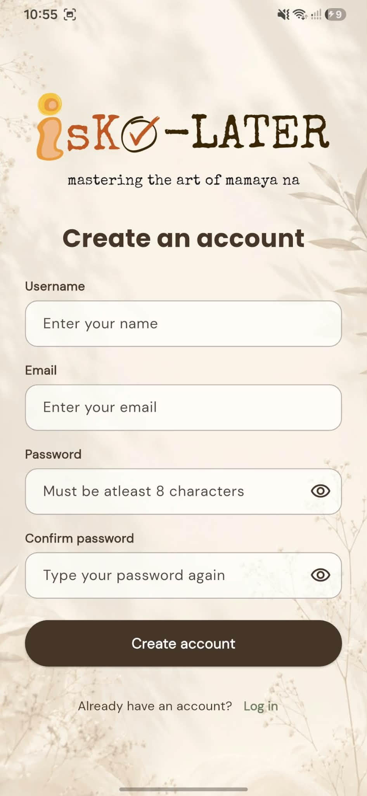 | 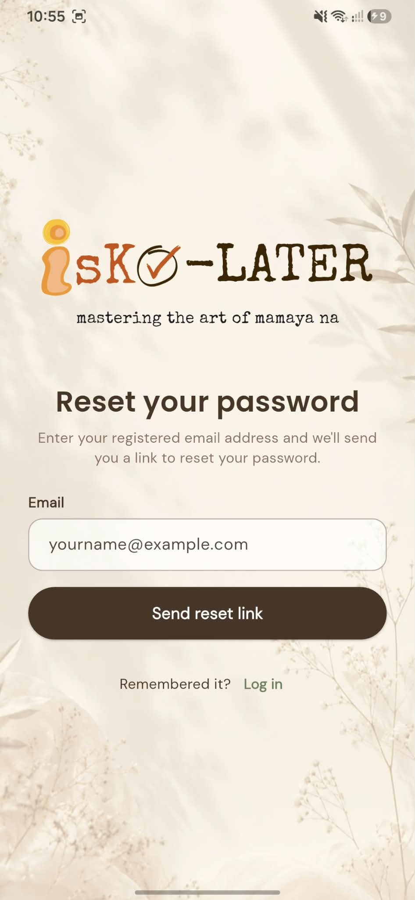 |
| *`screenshots/login_screen.jpg`* | *`screenshots/register_screen.jpg`* | *`screenshots/forgot_password_screen.jpg`* |

### 2. Personal & Collaborative Task Lists (Lab 1 + Lab 3)
| Personal To-Do List (Home) | Collaborative List Switcher | Shared Collaborative List View |
| :---: | :---: | :---: |
| 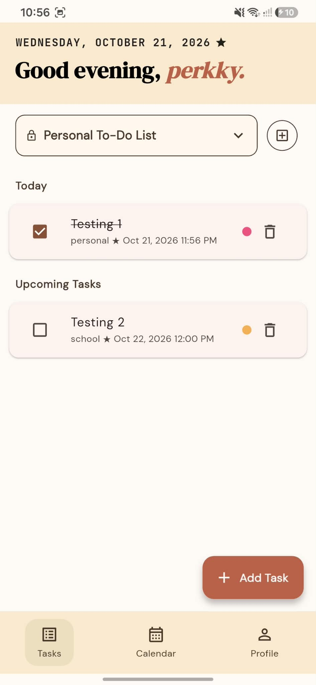 | 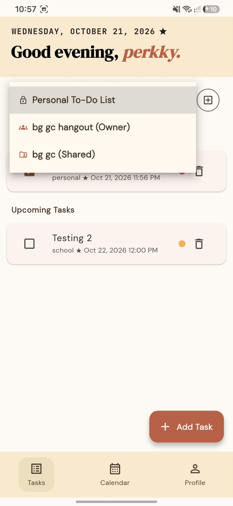 | 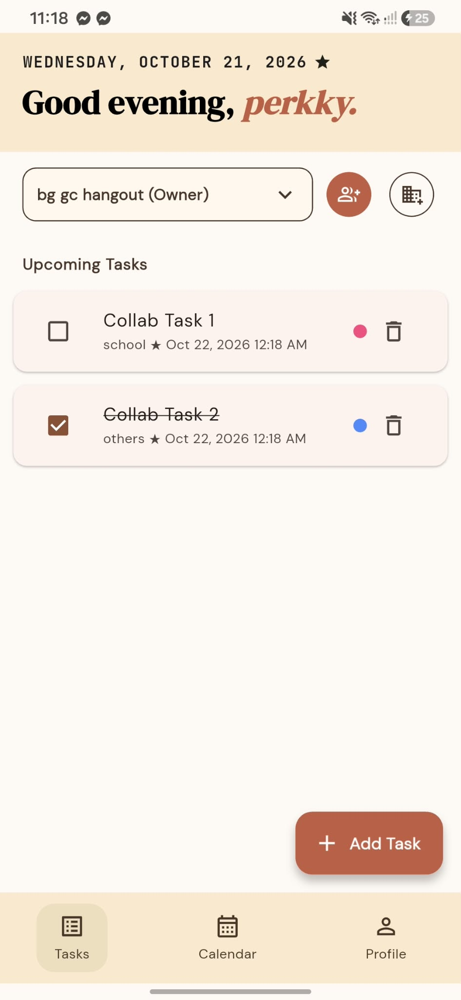 |
| *`screenshots/homeScreen_TaskList.jpg`* | *`screenshots/list_switcher_dropdown.jpg`* | *`screenshots/collab_list_tasks.jpg`* |

### 3. Task & Collaborative List Bottom Sheets (Lab 1 + Lab 3)
| Add / Edit Task Modal | New Collaborative List Sheet | Manage & Invite Members Sheet |
| :---: | :---: | :---: |
| 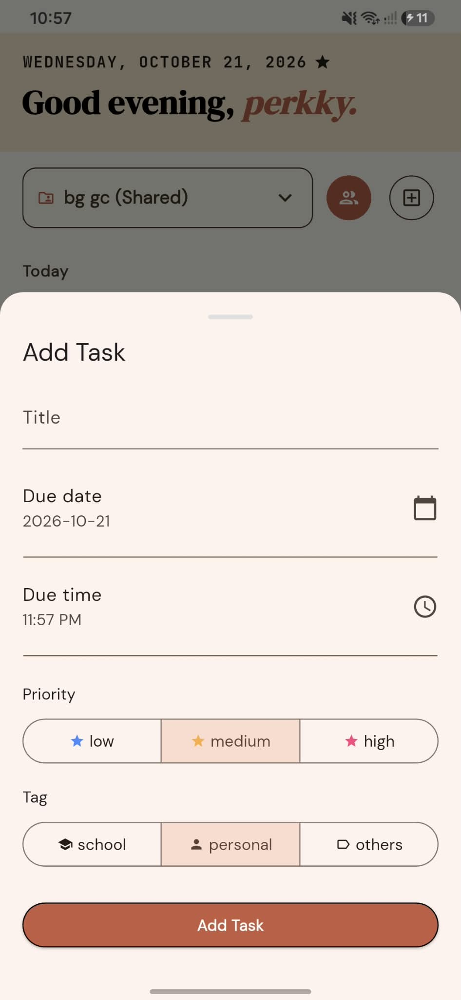 | 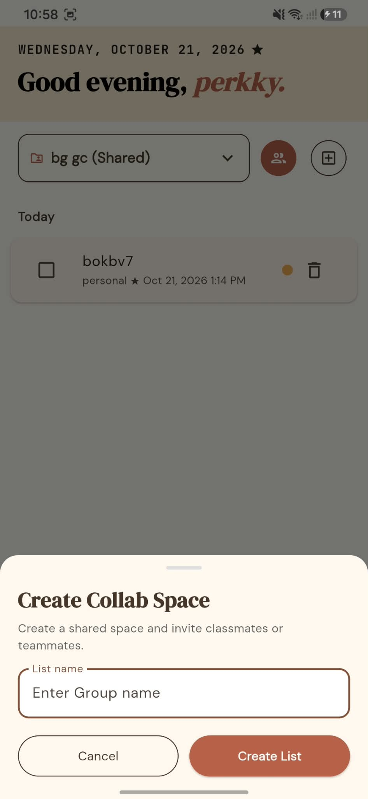 | 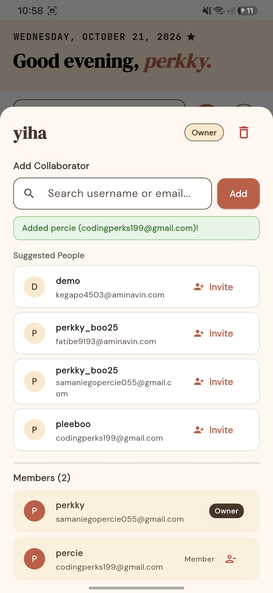 |
| *`screenshots/Add_Edit_modal.jpg`* | *`screenshots/create_collab_sheet.jpg`* | *`screenshots/invite_members_sheet.jpg`* |

### 4. Calendar & Profile Screens (Lab 1 + Lab 2 + Lab 3)
| Calendar View (Merged & Filtered) | Profile Screen | Firebase Console (DB Inspection) |
| :---: | :---: | :---: |
| 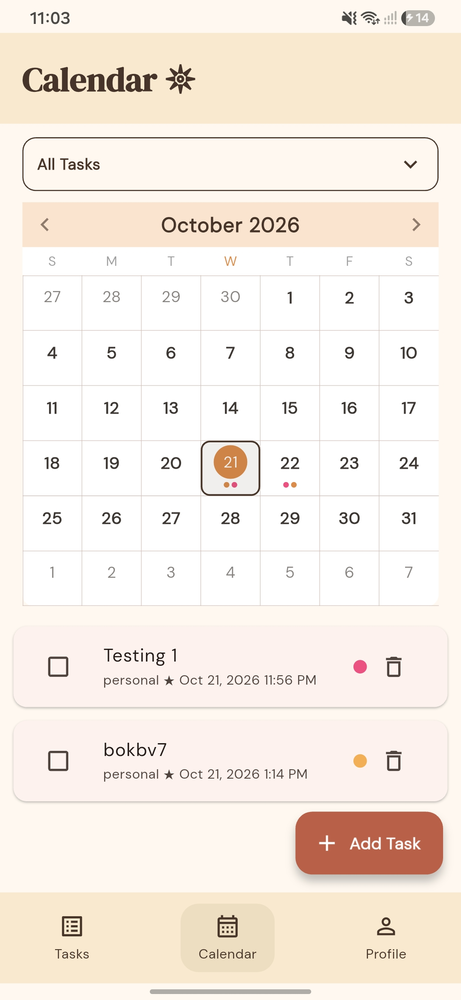 | 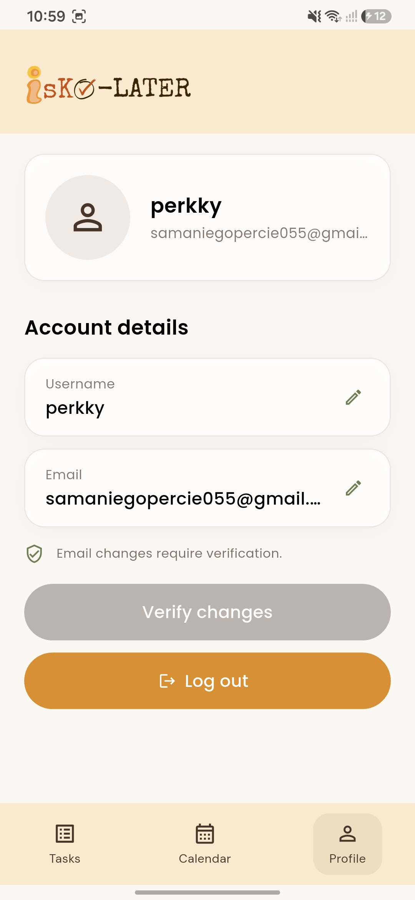 | 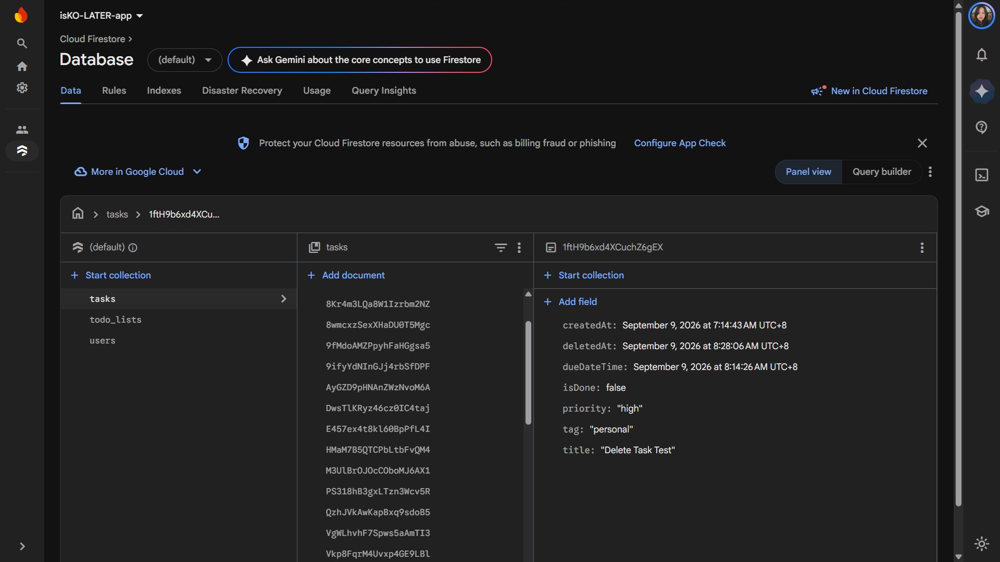 |
| *`screenshots/Calendar.jpg`* | *`screenshots/profile_screen.jpg`* | *`screenshots/firebase_inspection.jpg`* |

---

## How Activity 1 & Activity 2 Were Merged

### Branch & Merge Strategy
1. **Activity 1 (`main`)** established the core Flutter CRUD To-Do List (`HomeScreen`, `CalendarScreen`, `AddEditTaskSheet`, `Task`, and `FirestoreService`).
2. **Activity 2 (`act2-accounts`)** was branched from main and I built Firebase Authentication and account management (`AuthGate`, `LoginScreen`, `RegisterScreen`, `ForgotPasswordScreen`, `ProfileScreen`, `AppUser`, and `AuthService`).
3. **Activity 3 (`act3-ubac`)** was branched from `act2-accounts` since it was branched from  `main`:
   ```bash
   git checkout main
   git checkout -b act3-ubac
   git merge --no-ff act2-accounts
   ```

### What Changed During Integration & Conflict Resolution
- **Entry Point (`main.dart` & `AuthGate`)**: Retained `AuthGate` from `act2-accounts` as the root widget so unauthenticated users land on `LoginScreen` and authenticated users are routed directly to `HomeScreen`.
- **Schema Integration (`Task` + `AppUser` + `TodoList`)**: Updated `Task` (`lib/models/task.dart`) to include a required `ownerId` foreign key (referencing `users/{uid}`) and a nullable `listId` foreign key (referencing `todo_lists/{listId}`).
- **Service Separation (`FirestoreService` + `TodoListService`)**: Scoped `FirestoreService` queries and mutations to the logged-in user's `uid`, and extracted collaborative list management into a dedicated `TodoListService` (`lib/services/todo_list_service.dart`).
- **Session-Reactive UI**: Wrapped task streams in `HomeScreen` and `CalendarScreen` with `StreamBuilder<User?>` keyed by `uid` and reset `activeListId` upon logout so switching accounts immediately displays only the new user's tasks.

---

## Tech Stack

| Layer | Choice |
|---|---|
| Frontend | Flutter (Dart), Material 3 |
| Backend | Firebase (serverless backend) |
| Authentication | Firebase Authentication (Email/Password provider) |
| Database & RLS | Cloud Firestore + Firestore Security Rules (`firestore.rules`) |
| Other packages | `firebase_core`, `firebase_auth`, `cloud_firestore`, `syncfusion_flutter_calendar`, `google_fonts`, `intl` |

---

## Project Structure

```text
cmsc128-Lab1_CRUD_Samaniego/
├── firestore.rules                # Backend Row-Level Security (RLS) & IDOR prevention
├── firebase.json                  # Firebase project & rules configuration
├── lib/
│   ├── main.dart                  # App entry point & Firebase initialization
│   ├── firebase_options.dart      # Local Firebase config (gitignored)
│   ├── models/
│   │   ├── user.dart              # AppUser model (users/{uid})
│   │   ├── task.dart              # Task model with ownerId & listId foreign keys
│   │   └── todo_list.dart         # TodoList model with ownerId & memberIds array
│   ├── services/
│   │   ├── auth_service.dart      # Firebase Auth & user profile sync
│   │   ├── firestore_service.dart # User-scoped & list-scoped Task CRUD
│   │   └── todo_list_service.dart # Collaborative list CRUD & member invitations
│   ├── screens/
│   │   ├── auth_gate.dart         # Session persistence & route protection
│   │   ├── login_screen.dart
│   │   ├── register_screen.dart
│   │   ├── forgot_password_screen.dart
│   │   ├── profile_screen.dart
│   │   ├── home_screen.dart       # Personal & Collaborative task list screen
│   │   ├── calendar_screen.dart   # Merged & filterable month calendar view
│   │   ├── add_edit_task.dart     # Modal bottom sheet for creating/editing tasks
│   │   └── collab_list_sheets.dart# Modal bottom sheets for collab lists & invites
│   └── widgets/
│       ├── auth_widgets.dart
│       ├── app_shared.dart        # Shared FAB, bottom nav, & logout state reset
│       ├── list_switcher_bar.dart # Personal vs. Collaborative list dropdown bar
│       └── task_card.dart
└── screenshots/                   # App UI screenshots
```

---

## Data Model & Relational Schema

 Users, Collaborative Lists, and Tasks are stored in **three normalized top-level Firestore collections** (`users`, `todo_lists`, and `tasks`). User profile details (`userName`, `email`) are **never duplicated** inside task or list documents—relationships are maintained strictly through `uid` and `listId` references.

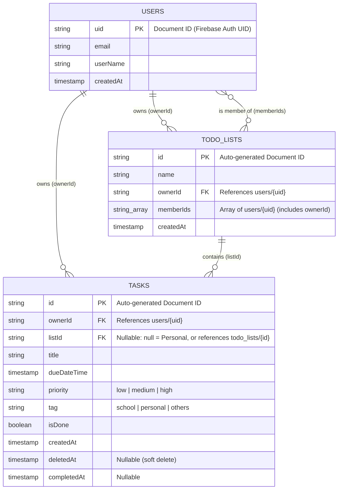

---

## UBAC, RLS, & IDOR Security Operations

Access control is enforced at **two layers**: inside the Dart service layer (`FirestoreService` & `TodoListService`) and on Google's backend servers via **Firestore Security Rules** (`firestore.rules`).

### 1. Reading Tasks (`streamTasks`)
- **Personal Tasks (`listId == null`)**: Queries `.where('ownerId', isEqualTo: uid)` so Firestore only returns tasks owned by the logged-in user.
- **Collaborative Tasks (`listId != null`)**: Queries `.where('listId', isEqualTo: listId)`, which `firestore.rules` permits **only** if `request.auth.uid in get(.../todo_lists/$(listId)).data.memberIds`.

```dart
// lib/services/firestore_service.dart
final query = (listId != null && listId.isNotEmpty)
    ? _taskRef.where('listId', isEqualTo: listId)
    : _taskRef.where('ownerId', isEqualTo: uid);
```

### 2. Mutating Tasks & Preventing IDOR (`_verifyOwnership` + `firestore.rules`)
Before updating, toggling, or deleting any task, the backend and service verify ownership (for personal tasks) or membership (for shared tasks), and lock `ownerId` and `listId` so they cannot be tampered with:

```javascript
// firestore.rules — tasks/{taskId}
allow update: if isAuthenticated() &&
                 isValidTask(request.resource.data) &&
                 request.resource.data.ownerId == resource.data.ownerId &&
                 request.resource.data.get('listId', null) == resource.data.get('listId', null) &&
                 request.resource.data.createdAt == resource.data.createdAt && (
                   (resource.data.get('listId', null) == null && resource.data.ownerId == request.auth.uid) ||
                   (resource.data.get('listId', null) is string && isListMember(resource.data.listId))
                 );
```

If Account A attempts to read, modify, or delete Account B's personal task (or a task in a collaborative list Account A was not added to) by guessing or changing its document ID, Firestore rejects the request with `PERMISSION_DENIED` (`403 Forbidden`).

### 3. Collaborative List Membership (`todo_lists/{listId}`)
- **Viewing Lists**: `_listRef.where('memberIds', arrayContains: uid)` paired with `allow read: if request.auth.uid in resource.data.memberIds;` guarantees users only see collaborative lists they own or were invited to.
- **Adding / Removing Members & Deleting Lists**: Restricted strictly to the list owner (`resource.data.ownerId == request.auth.uid`).

---

## Local Setup & Installation

### Prerequisites
- [Flutter SDK](https://docs.flutter.dev/get-started/install) (stable channel)
- [Firebase CLI](https://firebase.google.com/docs/cli) & [FlutterFire CLI](https://firebase.google.com/docs/flutter/setup)

### 1. Clone & Checkout `act3-ubac`
```bash
git clone https://github.com/CMSC128-njh/cmsc128-Lab1_CRUD_Samaniego.git
cd cmsc128-Lab1_CRUD_Samaniego
git checkout act3-ubac
flutter pub get
```

### 2. Configure Firebase & Deploy Security Rules
1. In the [Firebase Console](https://console.firebase.google.com), enable **Authentication → Email/Password** and create a **Cloud Firestore** database.
2. Publish the backend security rules in [`firestore.rules`](firestore.rules) via the **Firestore → Rules** tab, or run:
   ```bash
   firebase deploy --only firestore:rules
   ```
3. Generate your local `lib/firebase_options.dart` (if not already present):
   ```bash
   flutterfire configure
   ```

### 3. Run the Application
```bash
flutter run
```

---

## Authentication Flow

All authentication logic is handled in `lib/services/auth_service.dart`:
- **Registration & Login**: Uses `createUserWithEmailAndPassword` and `signInWithEmailAndPassword`, syncing the profile document (`email`, `userName`, `createdAt`) to `users/{uid}`.
- **Session Persistence**: `AuthGate` listens to `FirebaseAuth.instance.authStateChanges()`, keeping users logged into their own To-Do List across app restarts.
- **Logout Cleanup**: `logoutAndReturnToRoot()` resets `activeListId.value = null` before calling `signOut()`, ensuring the next account starts cleanly on their own Personal To-Do List.

---

## Inspecting Accounts & Tasks (Defense Deliverable)

During the defense, records can be inspected live in the **Firebase Console** without exposing plaintext passwords:

1. **Firebase Console → Authentication → Users**:
   - Displays registered accounts (`Email`, `User UID`, `Created`, `Signed In`) without exposing plaintext passwords.
2. **Firebase Console → Firestore Database → Data**:
   - **`users` collection**: Shows each user's `uid` document containing `email`, `userName`, and `createdAt`.
   - **`tasks` collection**: Shows each task's `ownerId` (matching `users/{uid}`) and `listId` (`null` for personal tasks, or matching `todo_lists/{listId}`).
   - **`todo_lists` collection**: Shows each collaborative list's `name`, `ownerId`, and `memberIds` array.

---

## Known Limitations

- Authentication is **Email/Password only** (no OAuth providers yet).
- Changing an account's email requires clicking the verification link sent to the new address before the update is finalized.

---


### Made for the Iskos who said:

> *"I'll do it later."*

…pero ma K-K.O LATER dahil sa burnt out.
